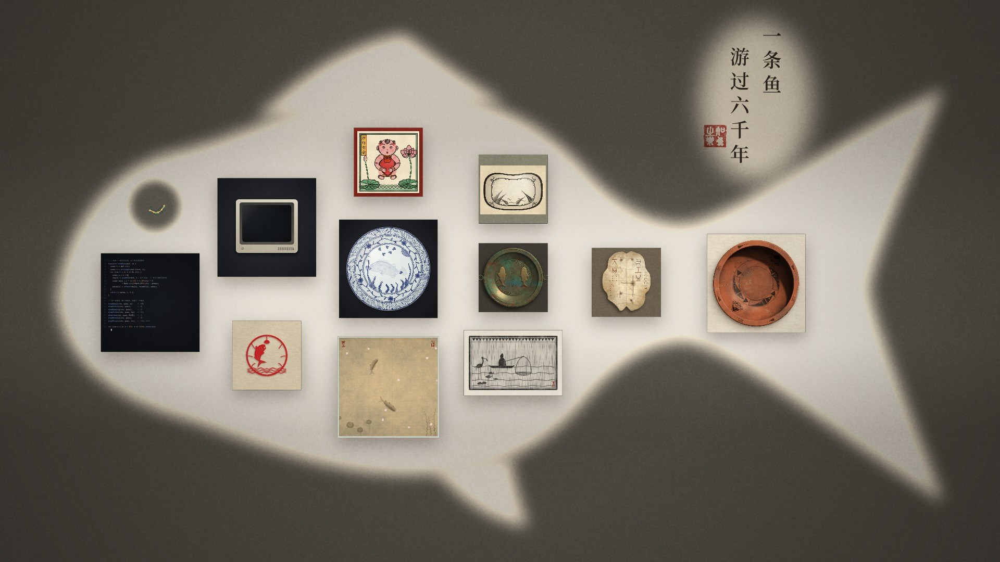
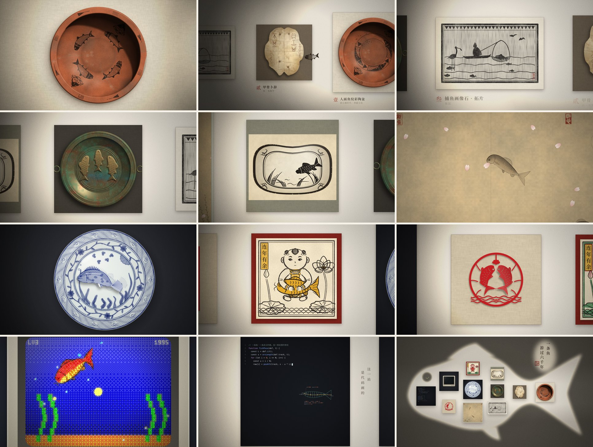

<div align="center">

# One Fish, Six Thousand Years



**A fish swims out of a six-thousand-year-old painted pottery basin and through eleven works of Chinese art.<br>Whatever it touches, it becomes.**

[▶ Watch online](https://fish6000.vercel.app) · [⬇ Download the 1080p 30 fps film](../../releases/latest) · [Changelog](CHANGELOG.md) · [中文](README.zh-CN.md)

</div>

---

The film runs 2 minutes 34 seconds. It uses no image assets and no recorded sound.

Every frame is drawn live by Canvas 2D code: the grit of the clay, the cracks in the turtle shell, the ink bloom of a stone rubbing, the weave of silk, the cobalt of blue-and-white porcelain, the frayed edge of cut paper. The score is synthesized sample by sample in Python.

This repository is the film. Clone it, open `film.html` in Chrome, and it plays.

## Eleven stations



| | Artwork | Period | What the fish becomes |
|:-:|---|---|---|
| 1 | Painted basin with human-face and fish motif | Neolithic · Yangshao culture | A painted pattern |
| 2 | Oracle-bone inscription | Shang | Strokes cut into turtle shell |
| 3 | Fishing scene, stone relief rubbing | Eastern Han | A catch: it swims into the net just as the fisherman lifts it, then leaps free |
| 4 | Bronze basin with twin fish | Eastern Han | Cast bronze |
| 5 | Cizhou pillow, black-on-white fish and weeds | Song–Jin | A few strokes of black brush |
| 6 | Fish among falling petals | Song · ink and color on silk | Drifting on silk with the petals |
| 7 | Blue-and-white dish with fish and weeds | Yuan · Jingdezhen | Painted, fired, turned blue |
| 8 | *Abundance Year after Year* | Qing · woodblock New Year print | Red and gold of the print |
| 9 | Twin fish | Folk paper-cut | Cut out of red paper by scissors |
| 10 | *Swim* | Video game · pixels | Shattered into pixels |
| 11 | This station | Code | Only the lines of code that draw it |
| Finale | | | Looking back, the path it took is a fish |

The artworks are redrawn in code after real relics and styles. They are not reproductions.

## Play it yourself

**Just watch:** open `film.html` in Chrome or Edge. Space plays, `[` `]` jump between stations, `,` `.` step one frame, `S` saves the current frame.

**Render to video:** requires Node.js 20+, ffmpeg and Chrome.

```bash
npm install
node render.js video film_silent.mp4 --jobs 4
node render.js mux film_silent.mp4 score_full.wav film.mp4
```

For 4K at 60 fps, add `--fps 60 --scale 2 --crf 20 --preset medium` to the second line. Every canvas is redrawn at twice the pixel density; nothing is upscaled.

**After editing the source:** run `python build.py` to assemble `film/` into `film.html`.

The full options, how to regenerate the score, which file draws which station, and the pitfalls worth knowing are in [docs/制作说明.md](docs/制作说明.md) (Chinese).

## How it moves

- **Each frame depends only on time.** The film is one function, `render(t)`. It holds no state between frames, so you can scrub anywhere and split rendering across many browsers at once.
- **The fish is a swinging spine.** It follows a path through keyframes. Its body is a chain of joints laid along the path it has just swum, and fins, scales and tail grow from that spine. All eleven styles share the same skeleton.
- **It becomes what it touches.** Each artwork has an outline. The part of the fish inside it takes the new style; the part outside keeps the old one. The change starts at the point of contact and spreads along the body.
- **The sound is computed too.** `score_full.py` synthesizes every note and splash with NumPy and places each one on the picture's timeline.

## License

The code is released under the [MIT License](LICENSE).

The embedded fonts are subsets of Noto Serif CJK SC and DejaVu Sans Mono, each under its own original license; see the [Noto font license](licenses/NotoSerifCJK-OFL.txt) and [DejaVu font license](licenses/DejaVu-LICENSE.txt).
