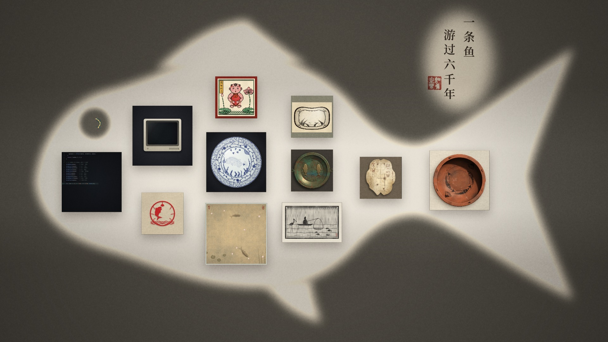
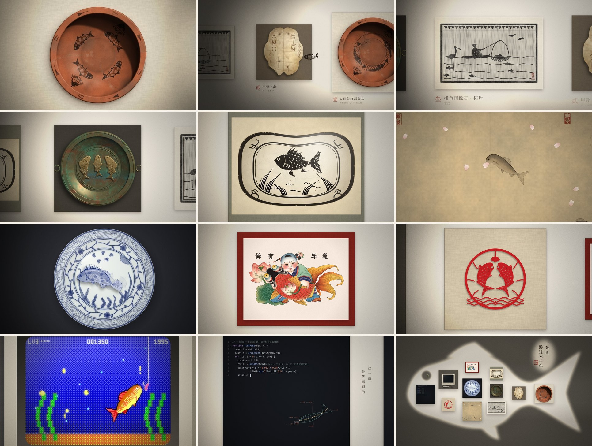

<div align="center">

# 一条鱼，游过六千年



**一条鱼从六千年前的彩陶盆里游出来，一路游过十一件中国艺术品。<br>每碰到一件，它就变成那件作品里的样子。**

[▶ 在线观看](https://fish6000.vercel.app) · [⬇ 下载 1080p 40 帧成片](../../releases/latest) · [更新记录](CHANGELOG.zh-CN.md) · [English](README.md)

</div>

---

片长两分五十三秒，没有用一张素材图，也没有一段录来的声音。

画面里的每一帧都由 Canvas 2D 代码当场画出：陶土的颗粒、龟甲的裂纹、拓片的墨晕、绢的经纬、青花的发色、剪纸的毛边，都是代码画的。配乐也是用 Python 一个采样一个采样算出来的。

整个仓库就是这部片子本身。clone 下来，用 Chrome 打开 `film.html`，它就开始放映。

## 十一站



| | 作品 | 年代 | 鱼在这里 |
|:-:|---|---|---|
| 壹 | 人面鱼纹彩陶盆 | 新石器时代 · 仰韶文化 | 画着画着，成了纹 |
| 贰 | 甲骨卜辞 | 商 | 化成甲骨文的刀刻笔画 |
| 叁 | 捕鱼画像石 · 拓片 | 东汉 | 正好撞进渔夫收起的网，又跳了出去 |
| 肆 | 双鱼铜洗 | 东汉 | 在盆里绕一圈，铸成了铜 |
| 伍 | 白地黑花鱼藻纹枕 | 宋金 · 磁州窑 | 变成几笔黑花 |
| 陆 | 落花游鱼 | 宋 · 绢本设色 | 在绢上和落花一起漂 |
| 柒 | 青花鱼藻纹盘 | 元 · 景德镇窑 | 落笔，入窑，烧出了蓝 |
| 捌 | 莲年有余 | 清 · 杨柳青木版年画 | 补上娃娃怀里那条鲤鱼，套色、点睛，一活就溜了 |
| 玖 | 双鱼 | 民间剪纸 | 被剪刀从红纸上剪了出来 |
| 拾 | 游 | 电子游戏 · 像素 | 碎成一格一格的像素 |
| 拾壹 | 这一站 | 代码 | 只剩画出它的那几行代码 |
| 终 | | | 回头看，走过的路是一条鱼 |

片中的作品都是照着真实的文物和样式，用代码重新画的，不是复制品。

## 自己放一遍

**只看：** 用 Chrome 或 Edge 打开 `film.html`。空格播放，`[` `]` 跳站，`,` `.` 逐帧，`S` 存下当前这一帧。

**渲染成视频：** 需要 Node.js 20+、ffmpeg 和 Chrome 或 Edge。成片是 40 帧/秒。

```bash
npm install
node render.js video film_silent.mp4 --fps 40 --crf 18 --preset veryfast --jobs 4
ffmpeg -i film_silent.mp4 -i score_film.m4a -map 0:v:0 -map 1:a:0 -c copy -movflags +faststart film.mp4
```

4K 运行 `python3 tools/export-4k.py --jobs 4`（另需 Python 3），直接得到带声的 `film-4k.mp4`（3840 × 2160）。这不是把 1080p 放大，而是把每张画布按两倍像素重画。

**改了代码之后：** 运行 `python build.py`，把 `film/` 里的源码重新拼成 `film.html`。

参数、配乐重新生成、每一站对应哪个文件、动手前该知道的几个坑，都写在 [docs/制作说明.md](docs/制作说明.md) 里。

## 它是怎么动起来的

- **每一帧只由时间决定。** 整部片子是一个函数 `render(t)`。给它一个时间，它就画出那一刻的画面，不依赖上一帧的状态。所以可以随意跳着看，也可以拆成很多段，交给多个浏览器同时渲染。
- **鱼是一根会摆的脊线。** 主角沿着一条由关键点连成的路游，身体是顺着走过的路排开的一串骨节，再沿脊线长出鳍、鳞和尾巴。十一种画法共用同一副骨架。
- **碰到什么，就变成什么。** 每件作品有自己的轮廓。鱼身在轮廓里面的部分换成新画法，外面的部分还是上一站的样子。所以变化是从鱼碰到作品的那一点开始，一寸寸蔓延过去的。
- **声音也是算出来的。** `score_full.py` 用 numpy 合成每一个音、每一下水声，再按画面里的时间点摆放好。
- **全片只有一条旋律。** 它的骨架是十个音，只用五声音阶里的五个音。每到一站，换一件乐器、换一个调式，再按这件乐器的脾气在骨架上添花：埙、石磬、排箫、编钟、笛子、古琴、琵琶、唢呐、板胡、芯片音乐。这和鱼换画法是同一个做法——脊线不变，画法在变。到了代码那一站，十行 `drawXxx` 一行一个音，只剩骨架；终章合起来完整奏一遍。

## 许可

代码以 [MIT](LICENSE) 许可发布。

内嵌字体包括 [Noto Serif CJK SC](licenses/NotoSerifCJK-OFL.txt) 和 [DejaVu Sans Mono](licenses/DejaVu-LICENSE.txt) 的子集。年画题字「蓮年有餘」出自片冈佑之的[佑字 肅](https://github.com/Kinutafontfactory/Yuji)，采用 [SIL Open Font License 1.1](fonts/OFL-Yuji.txt)。
